<div align="center">

# Inkpad

**A handwriting notebook for iPad with a warm, paper-and-ink feel.**
Notebooks, PDFs and endless canvases, built for Apple Pencil.

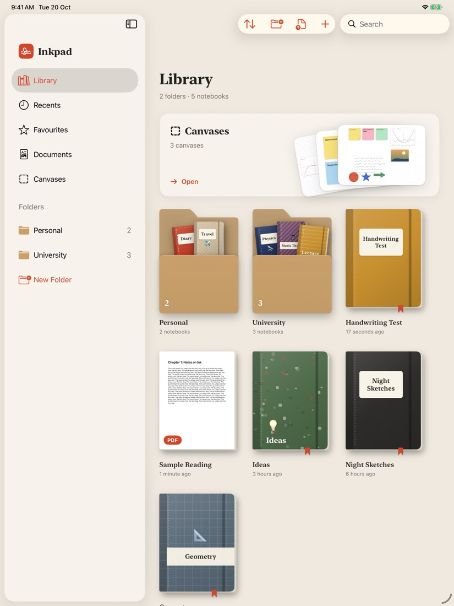

</div>

---

## Highlights

- **Writes like paper.** PencilKit ink with pen, fountain pen, pencil, highlighter and shapes, on lined, grid, dot, Cornell, music or isometric paper.
- **Notebooks that feel like objects.** Cloth, leather, linen and patterned covers with page edges, ribbons, labels, emoji, or your own photo.
- **Endless canvases.** A Freeform-style board for sticky notes, shapes, photos and graphs, kept in its own space apart from your notebooks.
- **Handwriting to text.** Search everything you've written, convert pages to text, or write with the Text Pen and watch it become typed text.
- **Maths built in.** LaTeX equations, function graphs, tables, a protractor and a unit converter.
- **Private by design.** Recognition, search and storage all happen on the iPad. No accounts, no servers.

## Writing

<table>
<tr>
<td width="50%">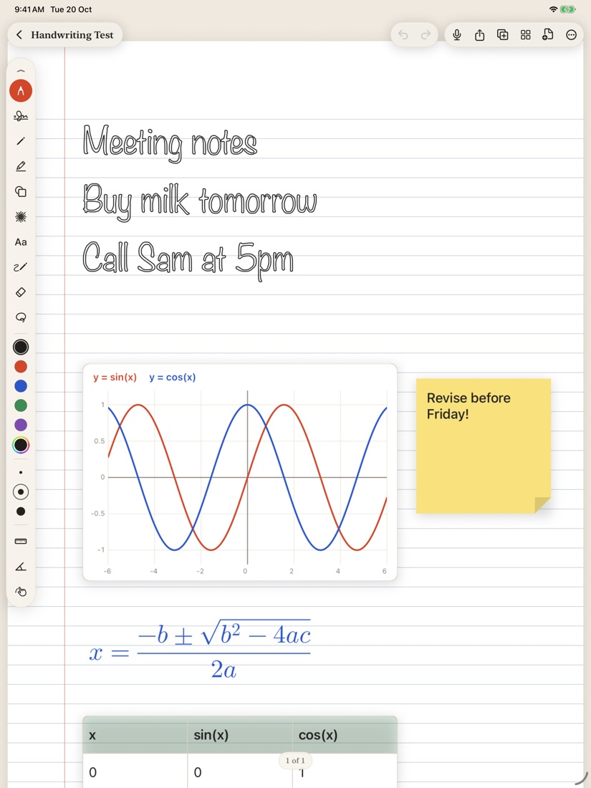</td>
<td width="50%">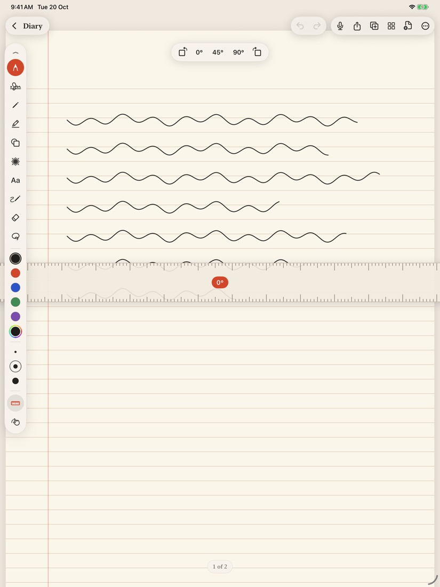</td>
</tr>
<tr>
<td><b>Notebook pages</b>: handwriting, graphs, LaTeX equations, tables and sticky notes on the same page. The Ink Rail floats beside the page and folds away to a single button.</td>
<td><b>Rotatable ruler</b>: twist with two fingers or use the angle buttons. It snaps to 45° steps and straightens lines drawn along its edge.</td>
</tr>
</table>

**The Ink Rail** holds every tool:

| Tool | What it does |
|---|---|
| Pen, fountain pen, pencil, highlighter | Colour palette plus a custom colour, three widths each |
| Shapes | Draw a rough circle, box, triangle or line and it snaps clean |
| Laser pen | **Trail** (stays until you pause), **Fade** (each stroke fades) or **Dot** (a pointer) |
| Text | Tap anywhere to type; drag to move, × to delete |
| Text Pen | Handwriting turns into typed text a moment after you stop |
| Eraser | **Object** and **Pixel** erasers in four sizes; also deletes text boxes |
| Lasso | Select, move and resize ink |
| Ruler and protractor | Rotate the ruler to draw straight lines at any angle; swing the protractor's arm to read angles |

Apple Pencil double-tap switches to the eraser or your last tool (following your system setting), and a left-handed layout moves the rail to the right.

## Pages

<table>
<tr>
<td width="50%">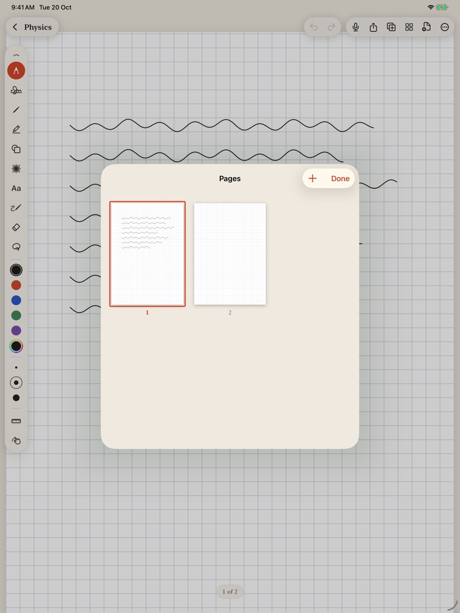</td>
<td width="50%">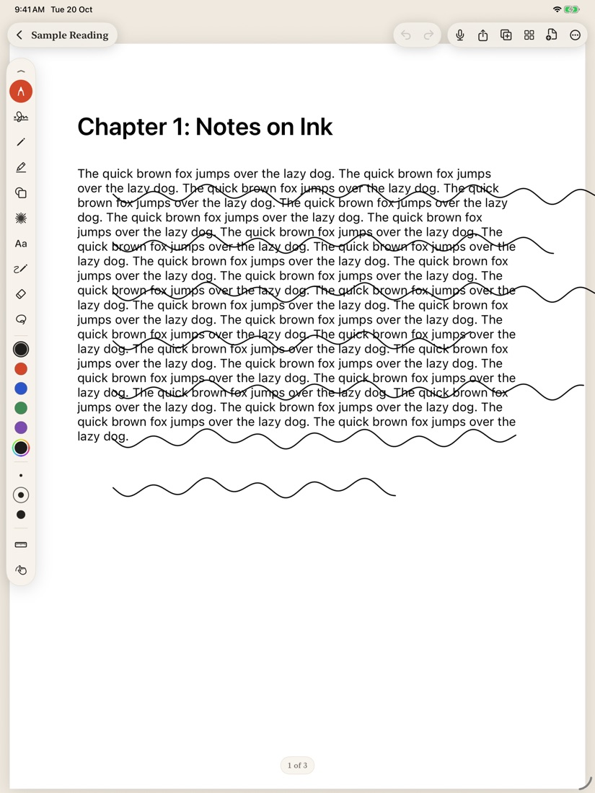</td>
</tr>
<tr>
<td><b>Page overview</b>: tap to jump, drag to reorder, long-press to insert, duplicate, change paper or delete.</td>
<td><b>PDFs</b>: import from Files and write on any page. Export any notebook back to PDF with ink and real, selectable text.</td>
</tr>
</table>

- Pages scroll vertically, or side by side with one-at-a-time swiping.
- Pull past the last page, or tap **Add Page**, to keep writing.
- Page sizes: **Fit Screen** (matches your iPad), A4, US Letter and Square.
- Paper colours: white, ivory and a dark "dusk" paper where black ink shows light.

## Canvases

<table>
<tr>
<td width="50%">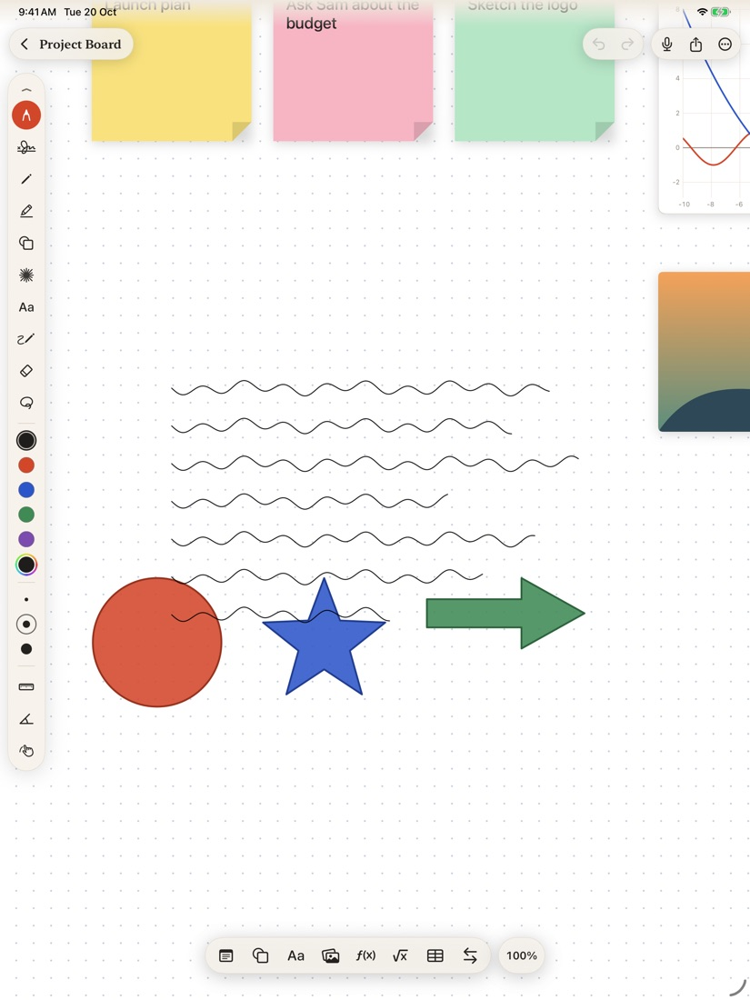</td>
<td width="50%">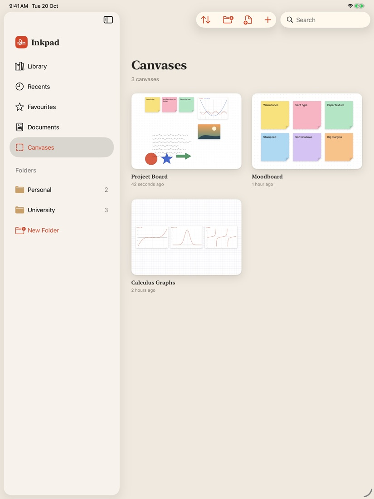</td>
</tr>
<tr>
<td><b>An endless board</b> with an insert bar for sticky notes, shapes, text, photos, graphs, equations and tables. Fingers move and resize objects while the Pencil keeps drawing over them.</td>
<td><b>Their own space</b>: canvases live behind the Canvases shelf in the Library, with live previews of each board.</td>
</tr>
</table>

## Maths tools

<table>
<tr>
<td width="50%">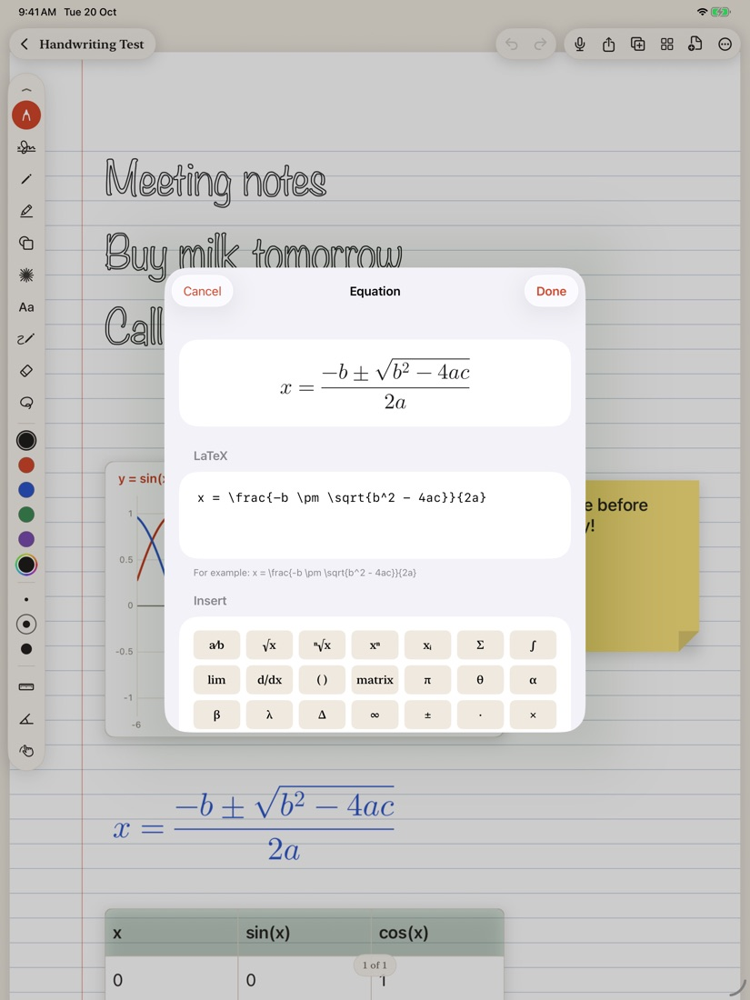</td>
<td width="50%">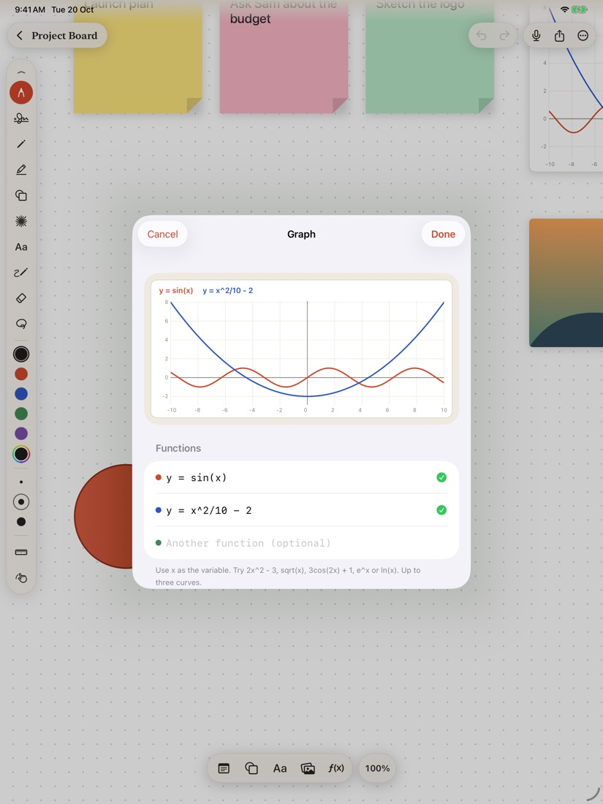</td>
</tr>
<tr>
<td><b>LaTeX equations</b>: type LaTeX or tap templates for fractions, roots, sums, integrals, limits, matrices and Greek letters. Typeset in Latin Modern, with a live preview.</td>
<td><b>Graphs</b>: up to three functions per graph, such as <code>2x^2 - 3</code>, <code>3cos(2x) + 1</code>, <code>e^x</code> or <code>sqrt(x)</code>, with a live preview and an adjustable x range.</td>
</tr>
<tr>
<td width="50%">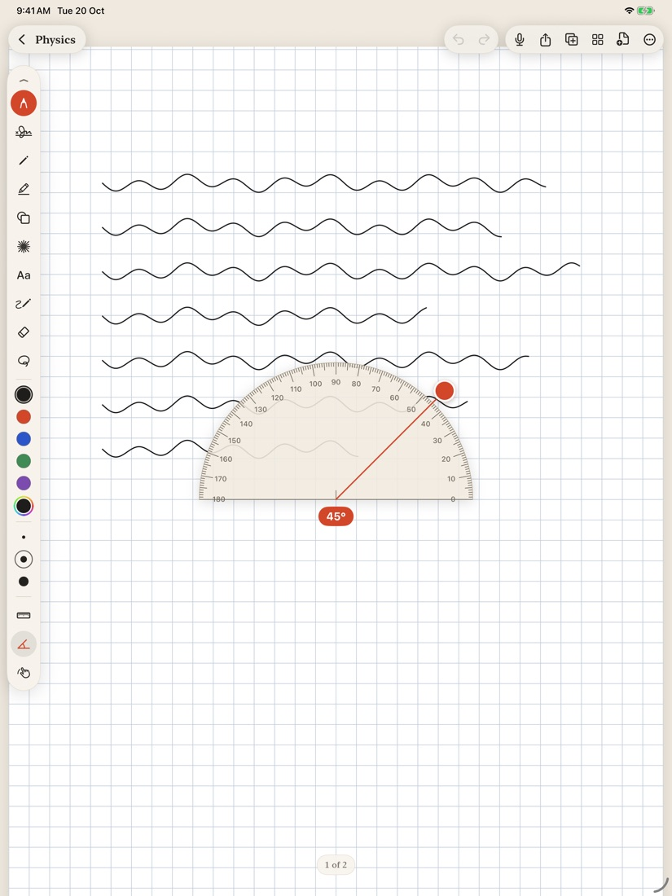</td>
<td width="50%">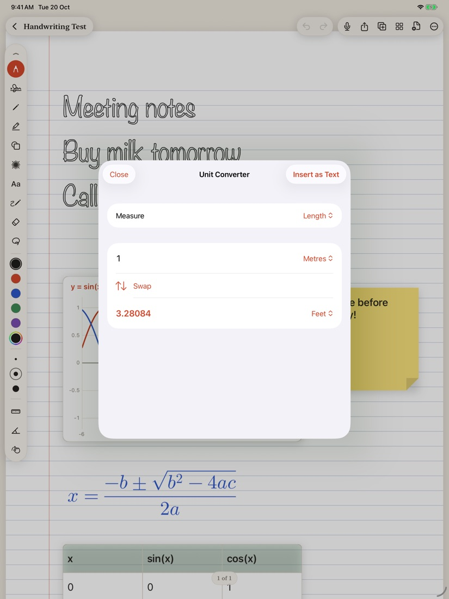</td>
</tr>
<tr>
<td><b>Protractor</b>: drag and twist it into place, then swing the arm to read the angle.</td>
<td><b>Unit converter</b>: length, mass, temperature, volume, area, speed, time and energy. Drop the result onto the page as text.</td>
</tr>
</table>

Tables (up to 8×8, with a header row) can be inserted from the same menu.

## Text

<p align="center">
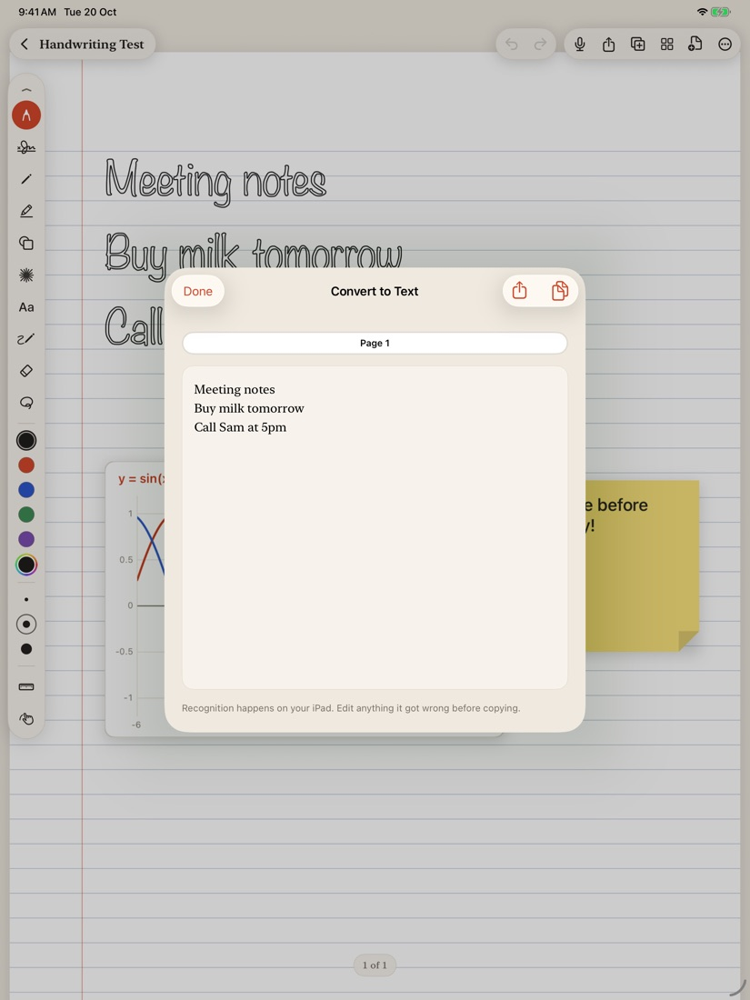
</p>

**Convert to Text** turns a page or a whole notebook into editable text you can copy or share, and the **Text Pen** converts as you write.

## Make it yours

<table>
<tr>
<td width="50%">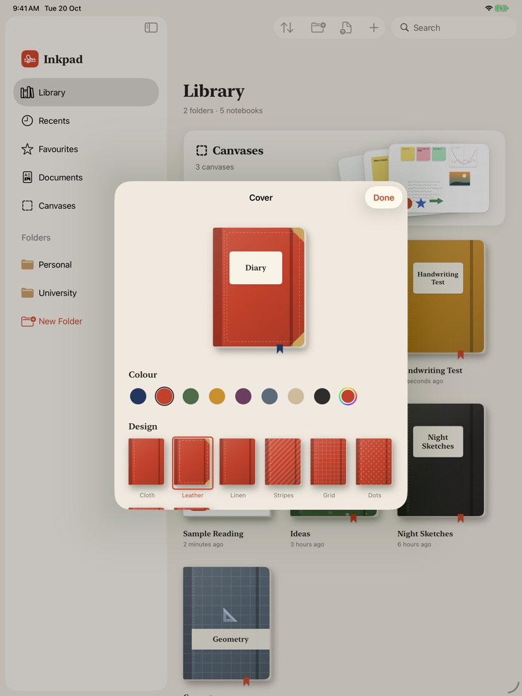</td>
<td width="50%">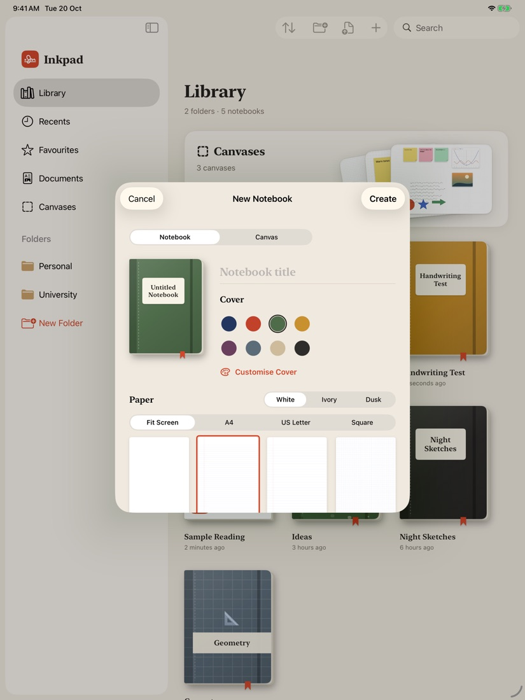</td>
</tr>
<tr>
<td><b>Covers</b>: 8 designs, any colour, four label styles, an emoji, a ribbon or your own photo.</td>
<td><b>New notebooks</b>: choose notebook or canvas, cover, paper, paper colour and page size.</td>
</tr>
</table>

Also included:

- **Library:** folders (shown as kraft folder tiles, drag notebooks onto them), favourites and recents.
- **Search:** finds titles, your handwriting, typed text and PDF text, with a snippet of each match.
- **Audio:** record lectures or meetings straight into a notebook.
- **Dark mode** throughout:

<p align="center">
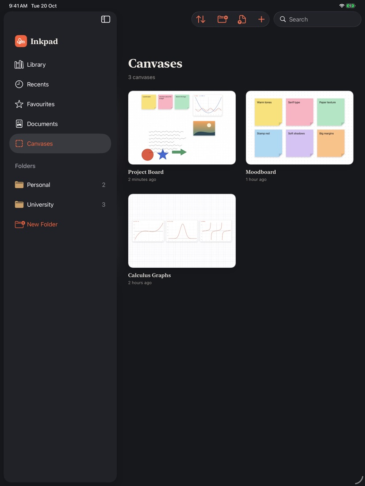
&nbsp;
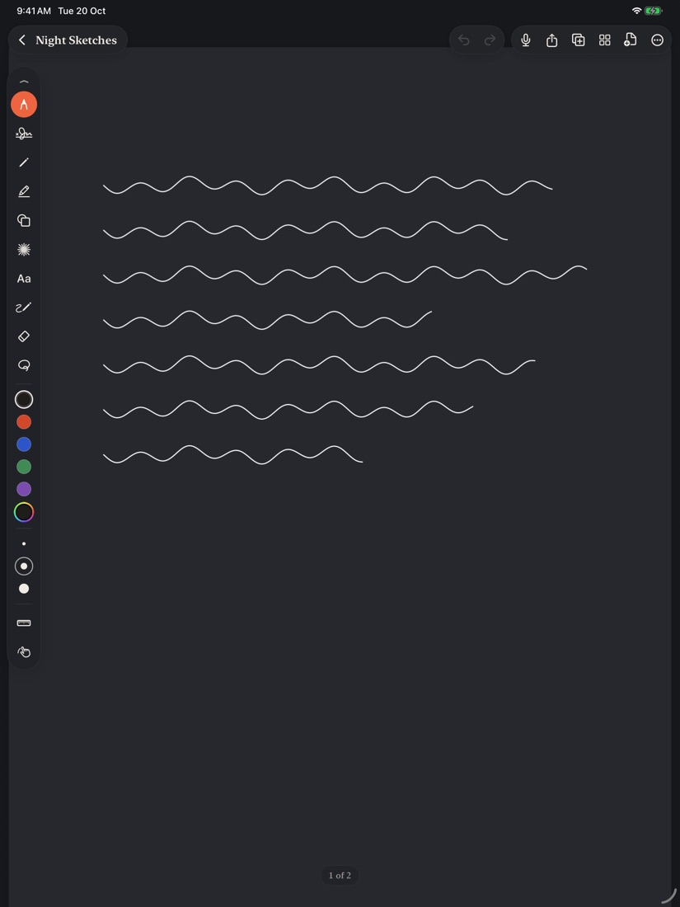
</p>

## Building

**Requirements:** Xcode 26 or later and an iPad on iPadOS 17 or later. A free Apple ID (Personal Team) is enough; Inkpad uses no paid capabilities.

1. Clone the repo and open `Inkpad.xcodeproj`.
2. Select the **Inkpad** target → **Signing & Capabilities** and choose your team. Change the bundle identifier if `com.pranavshukla.Inkpad` is taken.
3. Pick your iPad (or a simulator) and press **Run**.

On a free Personal Team, apps installed on a device expire after 7 days; run from Xcode again to refresh. Your notes are kept.

### Demo content

Debug builds accept launch arguments (**Product → Scheme → Edit Scheme → Arguments**) that fill the app with sample content, handy for trying things out in the simulator:

| Argument | Effect |
|---|---|
| `-seedDemo` | Replaces the library with sample notebooks, folders, a PDF and canvases |
| `-openNotebook "Diary"` | Opens a notebook by title on launch |
| `-section canvases` | Opens the Canvases section |

## Under the hood

Inkpad is plain Swift with Apple frameworks, plus [SwiftMath](https://github.com/mgriebling/SwiftMath) for typesetting LaTeX:

| Framework | Used for |
|---|---|
| SwiftUI | Library, sheets, toolbars |
| PencilKit | Ink, with a custom tiled page layout for sharp zooming |
| SwiftData | Notebooks, pages, folders, recordings and photos |
| PDFKit / Core Graphics | PDF import, vector paper patterns and PDF export |
| Vision | On-device handwriting recognition for search and Text Pen |
| AVFoundation | Audio recording and playback |
| SwiftMath | LaTeX equations (MIT licence) |

```
Inkpad/
├── Library/      Library, folders, new notebook sheet
├── Editor/       Canvas, Ink Rail, text boxes, items, laser, ruler
├── Rendering/    Paper patterns, page layout, item and graph drawing
├── Models/       SwiftData models and helpers
├── Design/       Theme, covers, folder tiles
├── Search/       Handwriting recognition and Convert to Text
├── PDF/          Import and export
└── Audio/        Recording
```
